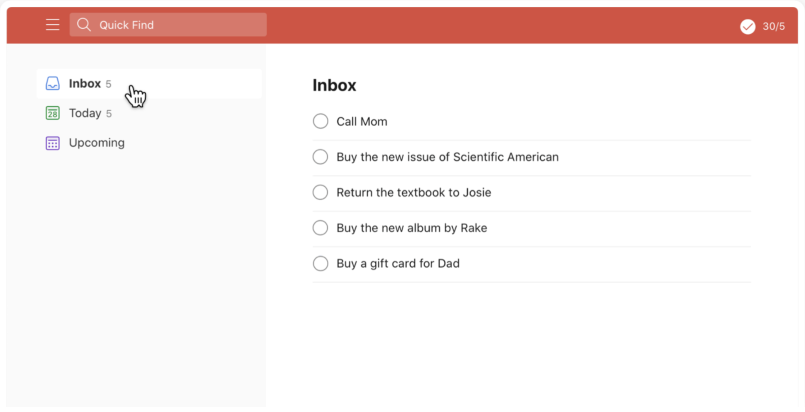

# Assignment 2: React Task Manager
## INFO 153A/253A Front-End Web Architecture - Fall 2026

**Points:** 100 points  
**Individual Assignment**  
**Released:** Monday, October 12, 2026, 9:00 AM PT  
**Due:** Friday, October 30, 2026, 9:00 AM PT (your last push before the deadline is what gets graded)

---

## Overview

Convert your Assignment 1 Task Manager from static HTML and CSS into an interactive React application. Same look, same mockup, now with working tasks.

---

## Learning Objectives

By completing this assignment, you will:
- Convert static HTML into React components
- Use JSX and props to compose a component tree
- Manage application state with `useState`
- Handle user events in React
- Build controlled form components

---

## Design Mockup

Your task manager should keep the Assignment 1 design:



The mockup is `task-manager-mockup.png` in this repository (the same file as in your Assignment 1 repository). Two things are new on top of it: a task counter in the header's upper-right corner, and three filter buttons under the "Inbox" heading.

---

## Requirements

### 1. Component Structure (20 points)

Create these React components, each in its own file:
- `App` - Main application container; owns the task data
- `TaskList` - Displays the list of tasks
- `TaskItem` - One task
- `TaskForm` - Form for adding a new task
- `TaskCounter` - Task statistics in the header, in the format "total / completed"

A separate `Header` component is optional.

### 2. Task Management (25 points)

- **Add Task**: a new task is added from the form input; empty or whitespace-only input adds nothing
- **Complete Task**: clicking a task's checkbox marks it complete or incomplete
- **Delete Task**: a task can be removed from the list
- **Task Counter**: the header's upper-right corner shows "total / completed" (for example "5/2" or "5 / 2": 5 tasks, 2 completed)
- **Empty State**: a message is shown when there are no tasks to display

### 3. React State Management (25 points, taught in the October 19 class)

- All task data lives in `App` state, managed with `useState`
- Data flows down to child components through props
- Child components report user actions back up through callback props
- State is updated without mutating the existing array or task objects
- The form input is a controlled component

### 4. User Interface (15 points)

- Matches the Assignment 1 design and keeps its responsive behavior
- Completed tasks are visually distinct from active tasks
- Hover and active states give feedback on interactive elements

### 5. Task Filtering (15 points, taught in the October 19 class)

- Three filter buttons: "All", "Active" and "Completed"
  - Recommended placement: a horizontal row under the "Inbox" heading with "|" separators ("All | Active | Completed")
- Clicking a button shows only the matching tasks
- The active filter button is highlighted (red, to match the Assignment 1 theme)
- The default filter is "All"
- The header counter always shows "total / completed" for all tasks, whatever the active filter

---

## Technical Requirements

### File Structure
```
assignment-2-<your-github-username>/
├── index.html
├── package.json
├── vite.config.js
└── src/
    ├── main.jsx
    ├── App.jsx
    ├── App.css
    ├── assets/              # Assignment 1 icons (already in the template)
    └── components/
        ├── TaskList.jsx
        ├── TaskItem.jsx
        ├── TaskForm.jsx
        └── TaskCounter.jsx
```

### Task Data Structure
Each task is an object with exactly these properties:
```javascript
{ id: 1, text: "Learn React", completed: false }
```
`id` is unique per task, `text` is the task description, `completed` is a boolean.

### Styling Requirements
- Reuse your Assignment 1 CSS: copy `styles.css` to `src/App.css` (the icons are already in `src/assets/`, so your existing `url(assets/...)` paths keep working)
- Keep the Assignment 1 responsive behavior (the left navigation disappears at 480px or less)
- In JSX the attribute is `className`, not `class`

### Code Quality Standards
- One component per file under `src/components/`
- Components communicate through props only; no global variables, no direct DOM manipulation
- Clean, consistently named components, props and handlers
- No libraries beyond what the template installs (React and Vite)

---

## Deliverables

### Required Files
1. **src/App.jsx** - the application and its state
2. **src/components/** - `TaskList.jsx`, `TaskItem.jsx`, `TaskForm.jsx`, `TaskCounter.jsx`
3. **src/App.css** - your Assignment 1 styling, adapted

### Getting the starter and submitting (GitHub, no Classroom)
1. Open the template repository: https://github.com/UCB-INFO-FRONTEND-WEBARCH/fl26-assignment-2-template
2. Click the green **Use this template** button and choose **Create a new repository**. Owner = your own GitHub account, Repository name = `assignment-2-<your-github-username>`, visibility **Public**. (This is your own copy, not a fork.)
3. Clone it and install:

```bash
git clone https://github.com/<your-github-username>/assignment-2-<your-github-username>.git
cd assignment-2-<your-github-username>
npm install        # a few minutes on classroom wifi; start it early
npm run dev        # then open http://localhost:5173
```

The template is a ready Vite + React project (the same versions as In-Person Project 5) with an empty `App.jsx`, your Assignment 1 icons in `src/assets/` and the mockup. You do not run `npm create vite` for this assignment. `node -v` must print 18 or newer.

4. **Commit and push** as you go. Your last push before Friday, October 30, 9:00 AM PT is what gets graded.
5. On bCourses, open Assignment 2 and submit the **URL of your repository** (the repository page, not a file) as the Website URL.

No deployment, no zip file, no live demo URL. Optional and not graded: a short paragraph at the end of your README on what felt different in React compared with the vanilla JavaScript of In-Person Project 4.

### Timing
The October 12 class covers components, JSX and props: the component structure and the styling can be finished after it. State, controlled forms and filtering are taught on October 19; plan the second half of the assignment for that week.

### Before you submit
- `npm install` then `npm run dev` works from a fresh clone (`node_modules` stays out of the repo; the template's `.gitignore` handles that)
- Add, complete, delete and filter tasks once each and check the counter after every step
- Check the 480px breakpoint
- The browser console shows no errors or React warnings

---

## Grading Rubric

### Component Structure (20 points)
- The five required components exist, each in its own file - **5 points**
- Component hierarchy is sound (App owns the data; TaskList renders TaskItems) - **5 points**
- Clean separation of concerns between components - **5 points**
- Props passed correctly between components - **5 points**

### Task Management Functionality (25 points)
- Add task works, and rejects empty input - **7 points**
- Complete and uncomplete a task works - **6 points**
- Delete task works - **6 points**
- Task counter in the header shows "total / completed" and stays correct - **3 points**
- Empty state message shows when there are no tasks - **3 points**

### React State Management (25 points)
- `useState` used correctly in App - **8 points**
- State updated immutably (no direct mutation of arrays or objects) - **7 points**
- Event handlers bound and working - **5 points**
- The form is a controlled component - **5 points**

### User Interface and Styling (15 points)
- Reuses the Assignment 1 CSS - **5 points**
- Responsive behavior kept from Assignment 1 - **3 points**
- Visual feedback on interactions (hover, active states) - **3 points**
- Completed tasks visually distinct (strikethrough, opacity, etc.) - **2 points**
- Clean, professional appearance - **2 points**

### Task Filtering (15 points)
- Filter buttons render and respond to clicks - **5 points**
- Tasks filter correctly by completion status - **5 points**
- Active filter button is highlighted - **3 points**
- Buttons in a horizontal row with separators (recommended pattern) - **2 points**

---

## Tips for Success

### Development Strategy
1. **Start with hard-coded data**: render a few sample tasks through your components before any state exists
2. **One feature at a time**: add, then complete, then delete, then filter
3. **Use React DevTools**: the browser extension shows your component tree, props and state
4. **Test after every change**: keep the dev server running and the console open

### Common Mistakes to Avoid
- Mutating state in place instead of creating a new array or object
- Missing `key` props when rendering a list
- An uncontrolled form input (the input's value not coming from state)
- Forgetting the empty state and the counter when testing filters

### Component Organization
```
src/components/TaskForm.jsx     # owns only the input's local state
src/components/TaskList.jsx     # receives the tasks to show and the handlers
src/components/TaskItem.jsx     # one task: checkbox, text, delete button
src/components/TaskCounter.jsx  # receives the two counts, renders "total / completed"
```

---

## Resources

### Required Reading
- React Front to Back, Chapters 1 to 4 (Course Introduction, React Basics and JSX, Components and Props, State)
- React Official Documentation: "Thinking in React"

### Tools
- **React Developer Tools**: browser extension for inspecting components and state
- **Vite documentation**: https://vitejs.dev/guide/
- **Browser DevTools**: console and responsive testing

### Getting Help
- Office hours for debugging sessions
- Class discussion for conceptual questions
- React documentation for syntax reference

---

## FAQ

**Q: Can I add extra features beyond task filtering?**  
A: Yes, but meet the requirements first. Extra features are not graded.

**Q: Do I need to match the Assignment 1 design exactly?**  
A: Close visual similarity is expected; small improvements are welcome.

**Q: Can I use external libraries?**  
A: No. Vanilla React only, with what the template installs.

**Q: Should the counter change when I filter?**  
A: No. The counter always shows all tasks: "total / completed". The filter only changes which tasks are listed.

**Q: Can I start before the October 19 class?**  
A: Yes. The component structure, props with hard-coded tasks, and the styling need only the October 12 material.

---

*Assignment 1 built this interface. Assignment 2 makes it work.*
